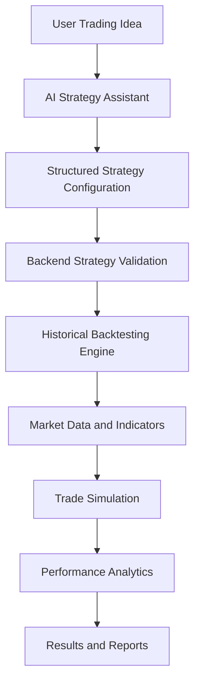

# TradeSim

### AI-Powered Cryptocurrency Strategy Analysis & Backtesting Platform

TradeSim is an AI-assisted cryptocurrency trading platform that transforms natural-language trading ideas into structured strategies, validates supported trading rules, and evaluates their historical performance through backtesting.

It combines AI-powered strategy interpretation with a Python-based backtesting engine to make trading strategy analysis more accessible, structured, and understandable.

---

## Key Features

### AI-Powered Strategy Assistant
- Describe trading strategies using natural language.
- Convert trading ideas into structured strategy configurations.
- Explain strategy logic, entry conditions, and exit conditions.
- Validate supported strategies before execution.
- Provide general strategy explanations for strategies outside the implemented execution capabilities.

### Historical Backtesting
- Simulate trading strategies using historical cryptocurrency market data.
- Evaluate strategy performance over selected historical periods.
- Process configurable trading conditions and technical indicators.
- Track asynchronous backtest execution.

### Technical Indicators & Strategy Engine
- SMA, EMA, RSI, and other implemented indicators.
- Configurable strategy conditions.
- Condition-based strategy evaluation.
- Automated entry and exit rule processing.

### Performance Analytics
- Equity curve visualization.
- Drawdown analysis.
- Trade history and performance metrics.
- Historical backtest reports.

### Authentication & Data Management
- Google Sign-In authentication.
- Secure backend-managed user sessions.
- User-specific backtest history.
- Persistent storage of backtest configurations and results using SQLite.

---

## How It Works

1. **Strategy Input:** Users describe their trading ideas in natural language.
2. **AI Interpretation:** Gemini interprets the idea and generates a structured strategy configuration.
3. **Backend Validation:** The backend checks whether the strategy is supported for execution.
4. **Backtesting:** The engine simulates the strategy using historical market data.
5. **Performance Analysis:** Trade history, equity curves, drawdowns, and performance metrics are generated.
6. **Results:** Users can review and revisit their historical backtests.

---

## Technology Stack

| Layer | Technologies |
|---|---|
| Frontend | React, JavaScript, CSS |
| Backend | Python, FastAPI |
| AI Integration | Google Gemini API |
| Authentication | Google Identity Services |
| Database | SQLite |
| Market Data | Binance Historical Data |
| Strategy Engine | Python, Pandas, NumPy |
| Build Tool | Vite |

---

## Application Modules

| Module | Responsibility |
|---|---|
| Dashboard | Overview of the trading simulation platform |
| AI Assistant | Natural-language strategy interpretation and explanations |
| Backtesting Engine | Historical strategy execution and simulation |
| Strategy Validation | Validation of supported trading configurations |
| Position Calculator | Position sizing and trading calculations |
| Backtest History | Persistent access to previous backtest runs |
| Performance Reports | Visualization and analysis of simulation results |

---

## Project Status

TradeSim currently includes:

- AI-powered trading strategy interpretation.
- Backend strategy validation and historical backtesting.
- Technical indicator and condition-based strategy execution.
- Google authentication and user-specific access.
- Persistent backtest history.
- Performance reporting and analytics.

Further development is planned for advanced interactive charting, multiple backtesting timeframes, and additional analytical capabilities.

---

## Disclaimer

TradeSim is an educational and research-oriented trading simulation platform.

Backtesting results are based on historical data and simulation assumptions. They do not guarantee future performance and should not be considered financial advice or a recommendation to buy or sell any financial asset.

**TradeSim does not place live exchange orders.**