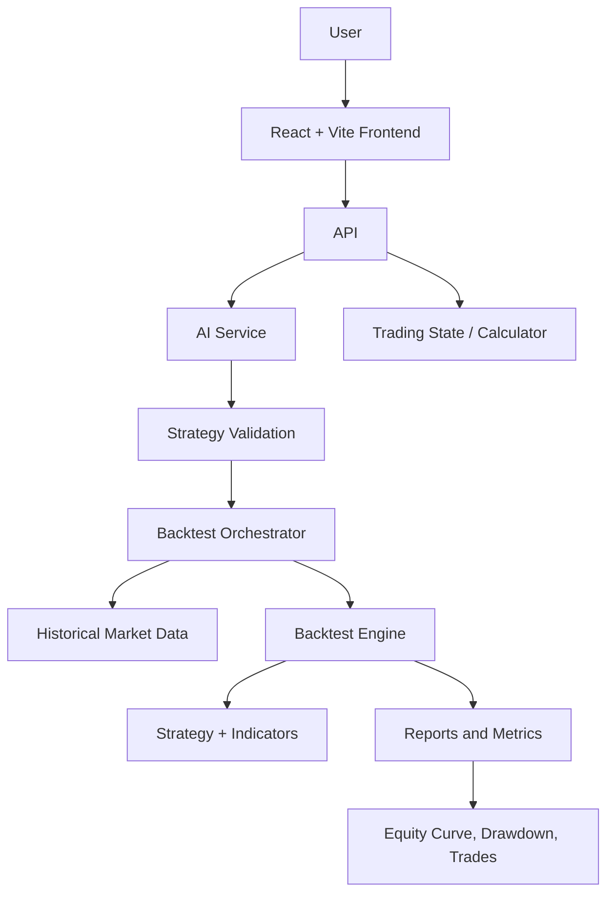

# TradeSim

AI-assisted cryptocurrency strategy analysis and historical backtesting platform.

TradeSim converts a trading idea into a structured strategy, validates supported rules, and runs a historical simulation. It also includes a React frontend, market-data utilities, trading-state management, and performance reports.

## Architecture



## Project structure

```text
tradesim-ai-test/
├── api.py                    # API entry point
├── ai_service.py             # AI strategy interpretation
├── ai_backtest.py            # AI-driven backtest workflow
├── backtest_*.py             # Data, engine, jobs and reporting
├── binance_market.py         # Binance market-data integration
├── historical_data.py        # Historical data utilities
├── indicators.py             # Technical indicators
├── condition_engine.py       # Strategy condition evaluation
├── strategy_schema.py        # Strategy structure and validation
├── config_validator.py       # Configuration validation
├── generic_strategy.py       # Condition-based strategies
├── strategies.py             # Strategy implementations
├── calculator.py             # Position calculations
├── liquidation.py            # Liquidation calculations
├── state_*.py                # Trading-state handling and validation
├── data/
│   ├── historical/           # BTCUSDT Spot and Futures 1h CSV data
│   └── trading_state.json
├── reports/                  # Generated charts and trade records
├── frontend/                 # React + Vite application
└── test_*.py                 # Tests
```

## Main components

- **Frontend:** React, Vite, JavaScript and CSS.
- **Backend:** Python API and backtesting modules.
- **AI:** Gemini-powered strategy interpretation.
- **Strategy logic:** SMA, EMA and RSI indicators with configurable conditions.
- **Market data:** Historical BTCUSDT CSV datasets and Binance integration.
- **Reports:** Equity curve, drawdown curve and trade history.

## Strategy workflow

1. Enter a trading idea in natural language.
2. AI converts it into a structured strategy configuration.
3. Backend validates the configuration and supported capabilities.
4. The backtest engine processes historical candles and simulates trades.
5. Results and performance reports are returned for display.

## Run locally

### Backend

Activate the project's virtual environment:

```bash
source venv/bin/activate
```

Install the Python dependencies used by the project if they are not already installed. Keep your API key in `.env` and never commit that file.

Start the API with the command matching the app object in `api.py`. If it exposes `app`, the command is:

```bash
uvicorn api:app --reload
```

### Frontend

```bash
cd frontend
npm install
npm run dev
```

## Tests

Run an individual test file, for example:

```bash
python -m pytest -q test_generic_backtest_integration.py
python -m pytest -q test_sma_backtest_integration.py
```

Some legacy test scripts may call external services. Run focused tests rather than the entire test directory until network-dependent tests are isolated.

## Current scope

- Strategy interpretation and validation are limited to the capabilities implemented in the backend.
- Historical datasets currently included in the repository are BTCUSDT Spot and Futures 1-hour CSV files.
- Backtest results depend on the selected dataset and the execution assumptions implemented by the engine.
- TradeSim is a simulation and analysis tool; it does not place live exchange orders.

## Disclaimer

Backtesting uses historical data and assumptions that may not reflect real market conditions. Results do not guarantee future performance and are not financial advice.
